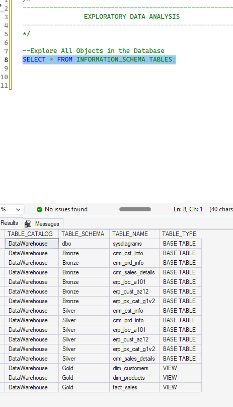

# Exploratory & Advanced Analytics on a Sales Data Warehouse (SQL Server)

SQL analysis of the **gold layer** of my [SQL Data Warehouse project](../README.md). It answers basic business questions: how big the business is, what drives revenue, how sales change over time, and who the best customers are.

## Dataset

Queried from the warehouse gold layer (star schema):

| Object | Type | Grain |
|---|---|---|
| `Gold.fact_sales` | Fact view | One row per order line |
| `Gold.dim_customers` | Dimension view | One row per customer |
| `Gold.dim_products` | Dimension view | One row per product |



Orders run from 2010-12-29 to 2014-01-28. 2010 and 2014 are partial years.

## Repository Structure

```
eda/
├── README.md
├── EDA.sql
├── Advanced eda.sql
├── reports/
│   ├── CustomerReport.sql
│   └── ProductReport.sql
└── images/
```

## Part 1: Exploratory Analysis (`EDA.sql`)

| # | Section | Purpose |
|---|---|---|
| 1 | Database exploration | Inspect tables and columns |
| 2 | Dimensions exploration | Countries, categories, products |
| 3 | Date exploration | Time span of data, customer age range |
| 4 | Measures exploration | Headline business metrics |
| 5 | Magnitude exploration | Measures by dimension |
| 6 | Ranking analysis | Top and bottom performers |

### Key Business Metrics

| Metric | Value |
|---|---|
| Total Sales | 29,356,250 |
| Total Quantity | 60,423 |
| Average Price | 486 |
| Total Orders | 27,659 |
| Total Products | 295 |
| Customers with at least one order | 18,484 |

### Findings

1. **Bikes bring in 96.46% of revenue** (28.3M), followed by accessories (0.7M) and clothing (0.3M).
2. **Five Mountain-200 variants generate about 6.67M, roughly 22.7% of all revenue.**
3. **The lowest-selling products are low-priced accessories**, such as Racing Socks and Patch Kits.
4. **Counting rows overstates orders.** `COUNT(order_number)` gives 60,398 but `COUNT(DISTINCT order_number)` gives 27,659, because the fact table has one row per order line.
5. **Many customers tie on order count.** The top customers placed 28 orders and at least ten more tied at 27, so `TOP 10` cuts the list arbitrarily. Ranking with `ROW_NUMBER` and revenue as a tie-breaker fixes this.
6. **The most frequent buyers are not the biggest spenders.** The top customers by revenue (ranked with `DENSE_RANK`) spent about 12,500 to 13,300 in only 5 to 6 orders, while the most frequent customers (27 to 28 orders) spent about 1,100 to 1,600.

## Part 2: Advanced Analytics (`Advanced eda.sql`)

| Section | Question answered | Techniques |
|---|---|---|
| Change over time | How do sales and customers move by day, month and year? | `YEAR`, `MONTH`, `COUNT(DISTINCT)` |
| Cumulative analysis | What is the running total of sales? | `SUM() OVER`, `PARTITION BY` |
| Performance analysis | How does each product compare with its average and the previous year? | CTEs, `AVG() OVER`, `LAG` |
| Part-to-whole | Which categories contribute most to sales? | `SUM() OVER ()` |
| Data segmentation | How are products and customers grouped? | `CASE`, CTEs |

### Findings

**1. Yearly trend.**

| Year | Total sales | Running total |
|---|---|---|
| 2010 (partial) | 43,419 | 43,419 |
| 2011 | 7,075,088 | 7,118,507 |
| 2012 | 5,842,231 | 12,960,738 |
| 2013 | 16,344,878 | 29,305,616 |
| 2014 (partial) | 45,642 | 29,351,258 |

Sales peaked in 2013 at 16.3M, nearly 2.8 times 2012, after a dip in 2012. *Yearly queries exclude rows with no order date, so the total is slightly below the overall 29,356,250.*

**2. Product performance.** 2014 has only one month of data, so most products show a "Decrease" in 2014. Year-over-year comparisons are only reliable up to 2013.

**3. Part-to-whole.** Bikes account for 96.46% of sales.

**4. Product cost segments.**

| Cost segment | Products |
|---|---|
| Below 100 | 110 |
| 100 - 500 | 101 |
| 500 - 1000 | 45 |
| Above 1000 | 39 |

**5. Customer segments.**

| Segment | Customers | Share |
|---|---|---|
| VIP | 1,655 | 9.0% |
| Regular | 2,198 | 11.9% |
| New | 14,631 | 79.2% |

VIP = 12+ months of history and spend over 5,000. Regular = 12+ months and spend of 5,000 or less. New = under 12 months. About 79% of customers are "New", so turning one-time buyers into repeat customers is the biggest opportunity.

## Part 3: Reporting Views (`reports/`)

Two reusable views for Power BI or other tools.

- **`Gold.report_customers`**: one row per customer with age group, segment (VIP / Regular / New), orders, sales, quantity, products, lifespan, recency, average order value and average monthly spend.
- **`Gold.report_products`**: one row per product with category, cost, segment (High Performer / Mid-Range / Low Performer), orders, customers, quantity, sales, lifespan, recency, average selling price and average monthly revenue.

*Recency is measured to today's date, but the data ends in 2014, so use it only to compare customers and products with each other.*

**Tools:** SQL Server, T-SQL, SSMS

- Next step: connect **Power BI** to `Gold.report_customers` and `Gold.report_products` and build a dashboard.

## Author

**Femila Abdul Kareem** (GitHub: [FemAbdul](https://github.com/FemAbdul))
